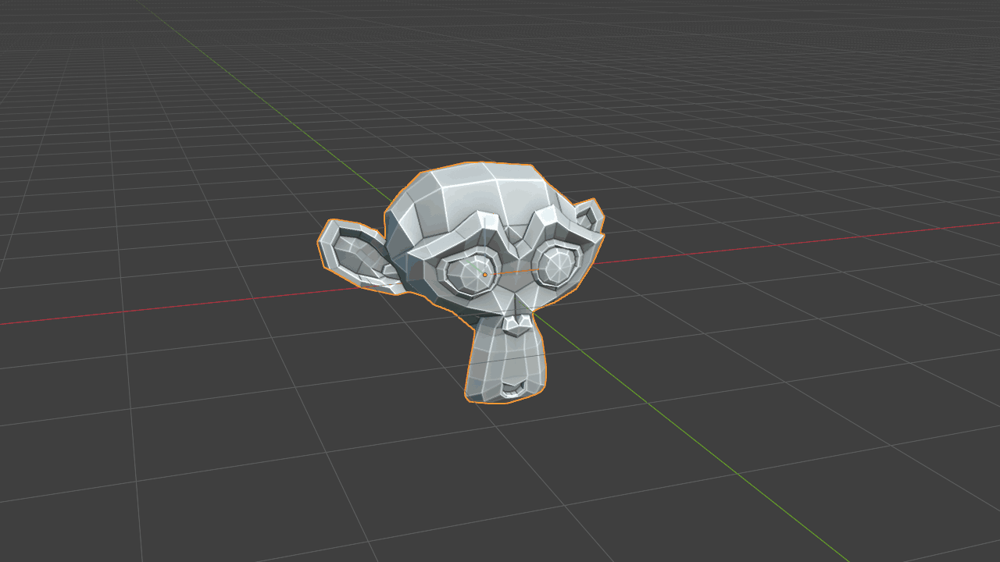
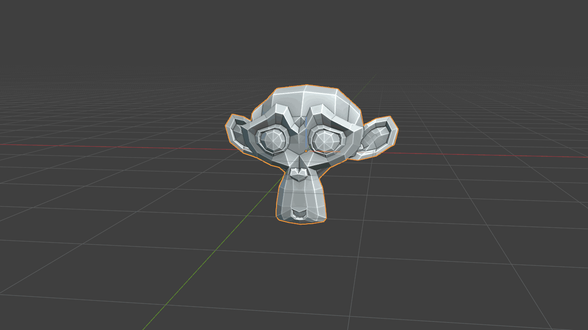

# Navigation

Viewport-aware transform tools designed for fast object manipulation.

## VP Step Rotate 45/-45

Rotate selected objects by 45 degrees around the local axis best aligned with the camera. By default, **Ctrl + Shift + Mouse Wheel Up** rotates **+45°**, and **Ctrl + Shift + Mouse Wheel Down** rotates **-45°** (Object Mode). You can change or disable these shortcuts under **Edit > Preferences > Add-ons > H3D Toolkit > Navigation Hotkeys**.

{ .media-center .media-medium }

## VP Axis Rotate

Hold the assigned Rotate shortcut (**R** by default) to rotate around whichever **local X, Y or Z axis points most toward the viewport**.

A quick tap still starts Blender's normal Rotate tool. When the configured hold delay elapses (**0.30 seconds** by default), H3D selects the best-facing local axis and hands off to Blender's native constrained Rotate transform, so snapping, numeric input and Shift precision continue to work normally. Set the shortcut and delay under **H3D Toolkit > Navigation Hotkeys** in Blender's Add-on Preferences.

## VP Planar Move

Automatically locks the axis facing the camera and moves objects along the other two axes. Hold the assigned Move shortcut (**G** by default) for the configured duration (**0.30 seconds** by default) to activate. A quick tap starts Blender's normal Move tool.

The shortcut and delay are adjustable under **H3D Toolkit > Navigation Hotkeys** in Blender's Add-on Preferences. The tap/hold shortcuts work in Object Mode and Mesh Edit Mode.

Each of the four navigation hotkeys (**VP Planar Move**, **VP Axis Rotate**, **VP Step Rotate +45°**, and **VP Step Rotate -45°**) also has an **enable/disable checkbox** in Add-on Preferences. Unchecking it removes that hotkey binding without clearing its assigned key, modifiers, or hold delay. Check it again to restore the saved binding. All shortcuts are enabled by default.

{ .media-center .media-medium }
