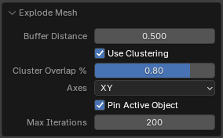
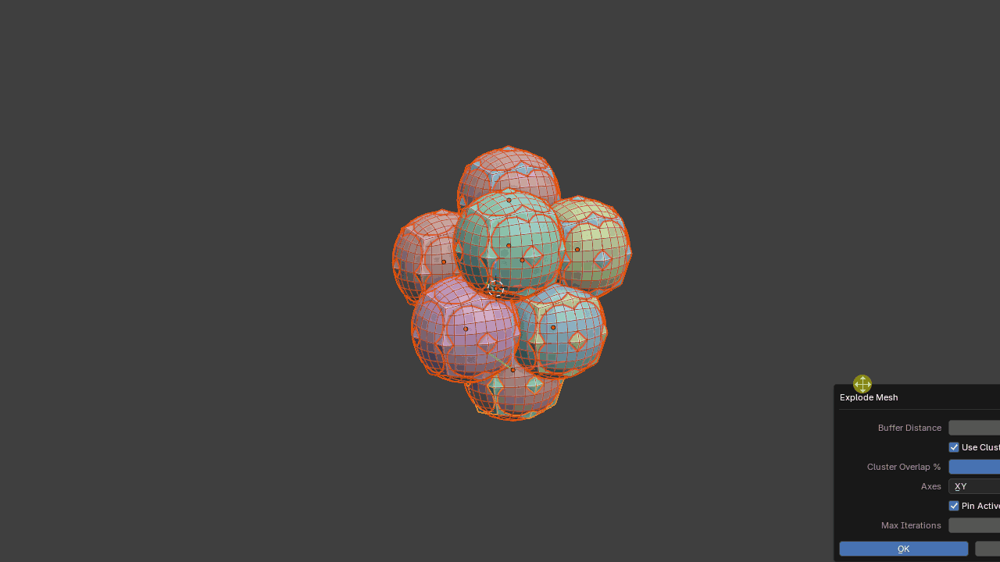
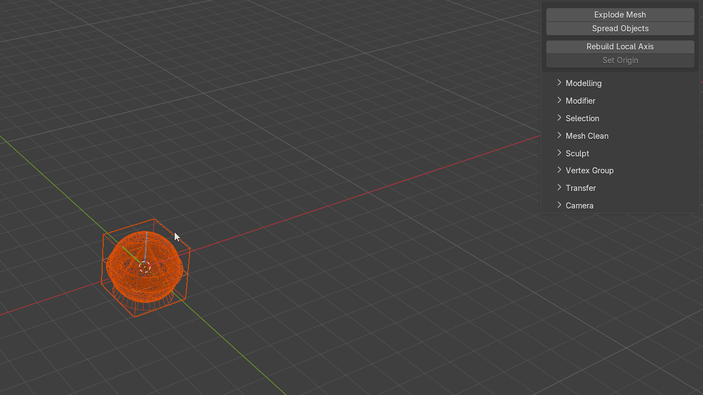
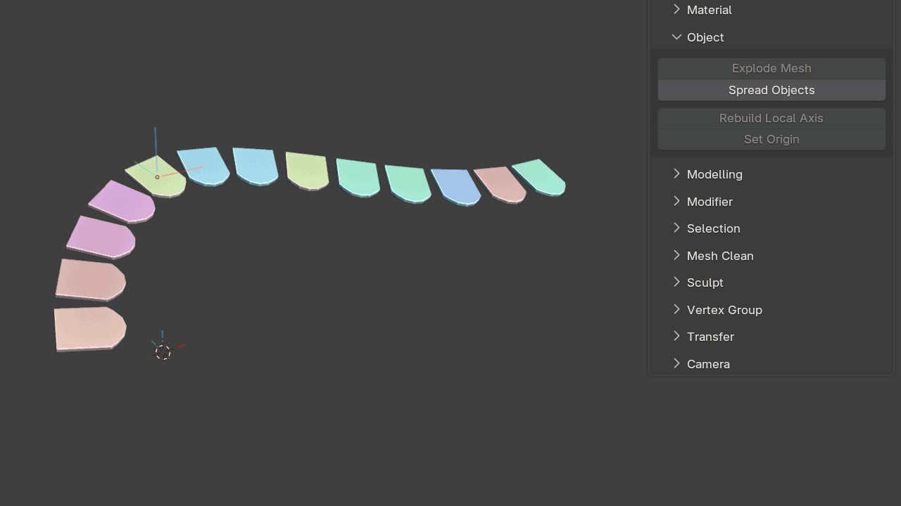
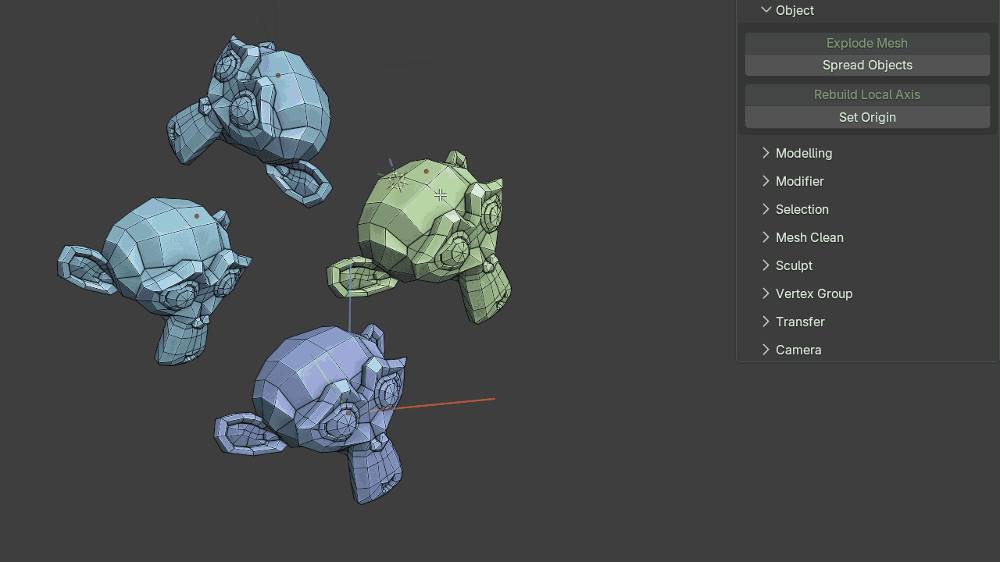

# Object

Object-level utilities for layout, baking preparation, local axes and origins.

## Explode Mesh

A baking-preparation operator that separates overlapping or intersecting geometry so meshes can be baked without nearby geometry interfering with the result.

The tool includes a clustering system that analyses object bounding boxes to keep related objects together.

This is particularly useful for matching high-resolution and low-resolution baking pairs. Objects with nearly identical spatial bounds can remain synchronized while the clusters are exploded away from surrounding geometry.

## Spread Objects

Spreads objects along either a line or a grid.

This is useful for organizing kitbash libraries or laying out large object collections for inspection.

## Rebuild Local Axis

Rebuilds the local axes and origin for selected mesh objects after transforms have been applied.

For each selected mesh object, the tool fits an oriented bounding box to the geometry and uses it to rebuild the local axes.

It can also sample nearest neighbours to encourage consistent axis orientation across many related objects, such as roof tiles.

{ .media-center .media-medium }

## Set Origin

Uses selected mesh components to position and orient the object's origin (multiple objects supported).

The orientation can be aligned to either world space or the selected component normals. When edges are selected, the origin's X axis is aligned exactly to the selected edge direction while the surface normal is derived from the linked faces. For a single selected vertex, the tool builds the orientation from the surrounding one-ring faces and directly connected edges. On quad topology it identifies the true opposite edge pairs around the vertex, follows the local edge-loop direction, and preserves that tangent exactly while fitting the surface normal around it.

Modifier-click behavior:

- **Click** = move and rotate the origin
- **Ctrl + Click** = rotate the origin only
- **Alt + Click** = move the origin only

{ .media-center .media-medium }

## Duplicate Source to Selected

Copies the **active (last-selected) source object** to the world location, rotation and scale of every other selected object. You can use a single mesh or curve, or an Empty with a full child hierarchy.

In **Object Mode**, select the destination objects first, then **Shift-select the source last** so it is active. Run **Duplicate Source to Selected** and choose a duplication method:

- **Linked Duplicates** — separate objects sharing the source's mesh/curve datablocks
- **Independent Copies** — separate objects with copied mesh/curve datablocks
- **Collection Instances** — lightweight instances of a single hidden source template collection

Enable **Include Children** to reproduce the entire source hierarchy, and **Select Results** to select the new copies after placement. The destination objects themselves are left unchanged.
